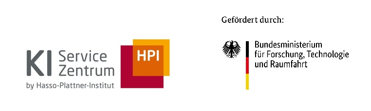
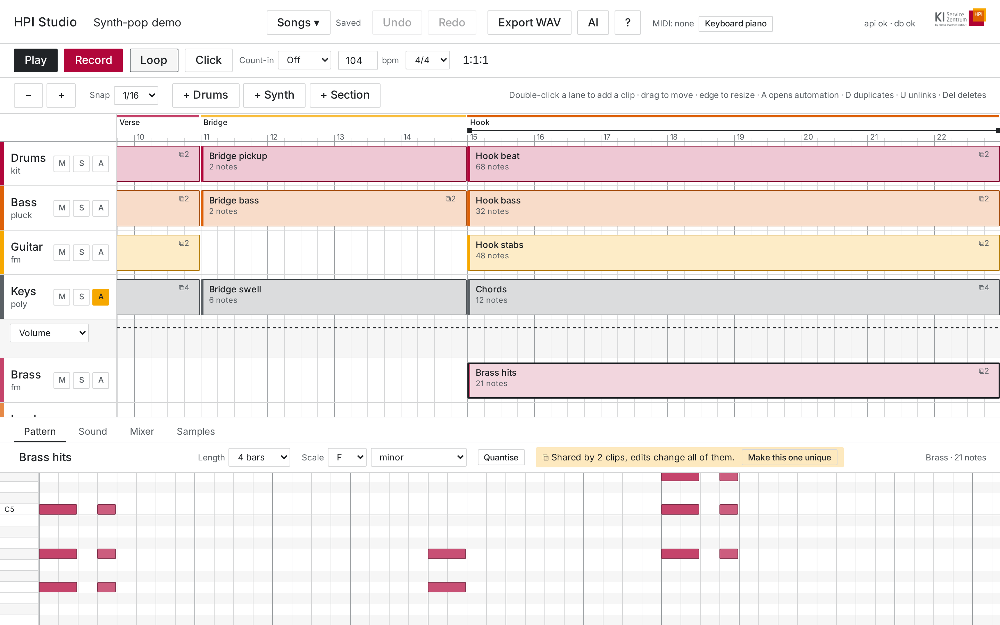

<div style="background-color: #ffffff; color: #000000; padding: 10px;">

<h1> Rapid Prototyping via Vibe Coding</h1>
</div>

An AISC workshop series on building software with coding assistants, from a first prototype pasted out of a chat window to a dockerised application with a frontend, a backend and an LLM behind it.

## Overview

"Vibe coding" is the practice of *describing what you want* and letting a coding assistant figure out *how to build it*. The series starts with a browser and a chatbot, then moves to [Claude Code](https://claude.com/claude-code) in your own repository, and teaches how to drive that environment well: keeping it focused, giving it verification hooks, and stopping it before it goes off the rails.

The material is organised into parts. Each part is a numbered folder under [`03_workshop/`](03_workshop/).

## Features

- **A working prototype in the first hour**, built without installing anything.
- **Copy-paste prompts** you run in a chatbot or in your own Claude Code terminal while reading.
- **Companion assets** (example `CLAUDE.md`, `settings.json`, skill, subagent) referenced from the notebooks.
- **Ecosystem tour**: the [`docling-toolkit`](https://github.com/docling-project/docling) plugin for document extraction, [`GEPA`](https://github.com/gepa-ai/gepa) for prompt optimisation, [`context-mode`](https://github.com/mksglu/context-mode) for tool-output sandboxing, and [`caveman`](https://github.com/JuliusBrussee/caveman) for output-token compression.



## Part 1 &mdash; Vibe Coding

[`03_workshop/01_workshop/`](03_workshop/01_workshop/)

Four prepared prompts that turn a chatbot into a drum machine you can play in your browser. No terminal, no installation, no code. It ends where chat-window prototyping ends: with something that works and that nobody has reviewed.

| File | Topic |
|------|-------|
| [`README.md`](03_workshop/01_workshop/README.md) | How to run the session, and what to do when the output does not work |
| [`01_beat_machine_prompt.txt`](03_workshop/01_workshop/01_beat_machine_prompt.txt) | A 16-step sequencer with eight drum sounds, tempo, loop, mute and volume |
| [`02_sound_design_prompt.txt`](03_workshop/01_workshop/02_sound_design_prompt.txt) | Tune, decay, filters, distortion, delay and reverb per instrument |
| [`03_database_prompt.txt`](03_workshop/01_workshop/03_database_prompt.txt) | Genre presets, saving to browser storage, export and import as JSON |
| [`04_feature_prompt.txt`](03_workshop/01_workshop/04_feature_prompt.txt) | Fill in a feature, get interviewed about it, leave with a prompt for a fresh chat |
| [`demo.py`](03_workshop/01_workshop/demo.py) | A marimo app that shows the finished results side by side with the code hidden |

## Part 2 &mdash; Claude Code Foundations

[`03_workshop/02_workshop/`](03_workshop/02_workshop/)

| Notebook | Topic |
|----------|-------|
| [`00_overview.ipynb`](03_workshop/02_workshop/00_overview.ipynb) | Orientation and prerequisites |
| [`01_claude_code.ipynb`](03_workshop/02_workshop/01_claude_code.ipynb) | Install, context window, verification, Plan Mode, prompt specificity |
| [`02_configure_your_environment.ipynb`](03_workshop/02_workshop/02_configure_your_environment.ipynb) | `CLAUDE.md`, permissions, CLI tools, MCP, hooks, skills, subagents, plugins |
| [`03_docling_toolkit.ipynb`](03_workshop/02_workshop/03_docling_toolkit.ipynb) | Document extraction with the Docling plugin |
| [`04_gepa.ipynb`](03_workshop/02_workshop/04_gepa.ipynb) | Automated prompt and agent-config optimisation |
| [`05_context_mode.ipynb`](03_workshop/02_workshop/05_context_mode.ipynb) | Tool-output sandboxing to save context-window tokens |
| [`06_caveman.ipynb`](03_workshop/02_workshop/06_caveman.ipynb) | Output-token compression via a terse-style skill |

Future parts will cover session management, automation and scaling, team workflows, and putting an LLM behind the prototype.

## Part 3 &mdash; HPI Studio

[`01_frontend/`](01_frontend/) &middot; [`02_backend/`](02_backend/) &middot; [`packages/shared/`](packages/shared/)

The counterweight to part 1. The same musical idea as the vibe-coded drum machine, built with planning mode, a real stack and high effort: a song-arrangement DAW with a linear timeline, linked clips, six synthesised instruments, a step grid and piano roll, a mixer with sends, microphone sampling, autosave to Postgres, undo and redo, render to WAV, and an AI assistant that edits the song from a chat. Everything you hear is generated by code or recorded by you; the repository ships no audio.

### Run it

You need Docker Desktop (see [Prerequisites](#prerequisites)) and nothing else. The images are published to GitHub Container Registry on every merge to `main`, so nothing is compiled on your machine:

```bash
git clone git@github.com:aihpi/workshop-rapid-prototyping.git
cd workshop-rapid-prototyping
docker compose pull && docker compose up --no-build
```

Open http://localhost:8080. Four services come up: Postgres, a one-shot migration and seed job, the Fastify API, and nginx serving the built frontend and proxying `/api`. The demo song is seeded on first start and plays on the first click. Stop with Ctrl C, or from the Containers tab in Docker Desktop; `docker compose down -v` also deletes the database and recorded samples.

To build the images from your checkout instead, for instance after changing the code:

```bash
docker compose up --build
```

The first build takes a few minutes and about 4 GB of memory; Docker Desktop's default allowance is enough.

### AI assistant

The AI button in the top bar (or Ctrl K) opens a drawer where you describe a change in words: "make the drums deeper", "more reverb on the keys and pan them left", "the hook should be played by three trumpets and a saxophone", or a question such as "what key is this song in?". The model answers with operations in the app's own vocabulary; the server validates them and the client applies them as a single undo step, so Ctrl Z removes a whole reply. The assistant can change tempo, tracks, instruments, mix, patterns, notes, clips and sections. It cannot touch recorded samples.

It needs a key for the [HPI AISC model hub](https://api.aisc.hpi.de), which you receive from the workshop organiser. Copy the example file, fill in the key and start (or restart) the stack:

```bash
cp .env.example .env
docker compose up --no-build
```

`.env` is gitignored and read by the API container only. Without it the drawer explains what is missing and everything else works as before.

#### Choosing a model

Three of the hub's chat models were compared with the harness in [`02_backend/scripts/ai-eval.ts`](02_backend/scripts/ai-eval.ts): ten prompts from "set the tempo to 120" to "the hook should start soft and slowly explode", each with a mechanical check of the resulting document, two runs each. *Valid* means the reply parsed and every operation applied; *intent* means the check passed.

| Model | Valid | Intent | Median latency | Notes |
|-------|-------|--------|----------------|-------|
| `gpt-oss-120b` (default) | 20/20 | 16/20 | 3.8 s | Most thorough on multi-step edits (new tracks with patterns and clips, crescendos); wordier and slower on the big ones |
| `llama-3-3-70b` | 20/20 | 14/20 | 3.2 s | Fastest and terse; creates tracks but forgets to give them clips, and puts the outro pattern in the wrong place |
| `gemma-4-31b` | 20/20 | 13/20 | 4.5 s | Good on mix and instrument edits; weaker at rewriting notes for a section |

All three failed the same question: asked for the key, each names A flat or C sharp because that is the most frequent pitch class, while the song is in F minor. Music theory from a note list is not what these models are good at; edits are.

Run it yourself with a `.env` in place:

```bash
npm run ai:eval -w 02_backend -- --models gpt-oss-120b,llama-3-3-70b --runs 2
```

Results land in `tmp/` (gitignored). The default model is set with `AI_DEFAULT_MODEL` in `.env`.

### Where things are

| Where | What |
|-------|------|
| [`packages/shared/src/song.ts`](packages/shared/src/song.ts) | The zod song document both sides validate against |
| [`packages/shared/src/ops.ts`](packages/shared/src/ops.ts) | Pure operations; each one is one undo step in the client |
| [`packages/shared/src/aiOps.ts`](packages/shared/src/aiOps.ts) | The operation vocabulary the assistant speaks, and how a batch is applied |
| [`01_frontend/src/audio/`](01_frontend/src/audio/) | Tone.js engine: pure graph factory, reconciler, offline renderer |
| [`01_frontend/src/state/`](01_frontend/src/state/) | Undoable song store over Immer patches, transient UI store |
| [`01_frontend/src/timeline/`](01_frontend/src/timeline/) | Sticky-header timeline, canvas grid, DOM clips, pointer gestures |
| [`01_frontend/src/ai/`](01_frontend/src/ai/) | The assistant drawer and the one place AI output enters the document |
| [`02_backend/src/routes/`](02_backend/src/routes/) | Songs with optimistic locking, samples on a volume, the AI chat route |
| [`02_backend/src/ai/`](02_backend/src/ai/) | Prompt, gateway client, JSON extraction, one repair round |
| [`e2e/`](e2e/) | Playwright: load, play, edit, record, render, mixer, AI drawer |

For development without Docker for the app itself: `docker compose up db`, then `npm ci`, `npm run migrate`, `npm run dev:api` and `npm run dev:web` in two terminals, and open `http://localhost:5173`. `npm test` runs the unit tests, `npm run e2e` the browser test.

## Setup

### Prerequisites

Part 1 needs a browser and an account for a chatbot. Nothing else. Part 3 needs Docker Desktop and nothing else. The rest of this list is for part 2.

- Terminal on macOS or Linux (Windows works via WSL2).
- **Node.js &ge; 18** for Claude Code and `context-mode` (22+ recommended on Linux, and 22 for developing part 3).
- **Python 3.11+** with `uv` for Docling, GEPA and the marimo app.
- **Git**, and a project directory under version control so you can see what Claude changes.
- An **Anthropic account** for logging into Claude Code.
- *(optional)* the **`gh` CLI** for GitHub workflows.

#### Install Docker Desktop

Docker Desktop bundles the Docker engine, the `docker compose` command and a small GUI for starting and stopping containers.

| System | Download | Notes |
|--------|----------|-------|
| macOS | [Apple silicon](https://desktop.docker.com/mac/main/arm64/Docker.dmg) or [Intel](https://desktop.docker.com/mac/main/amd64/Docker.dmg) | Drag to Applications, start it once, accept the licence |
| Windows | [Docker Desktop for Windows](https://desktop.docker.com/win/main/amd64/Docker%20Desktop%20Installer.exe) | Needs WSL 2; the installer offers to enable it. Run the commands from a WSL or PowerShell terminal |
| Linux | [Docker Desktop for Linux](https://docs.docker.com/desktop/setup/install/linux/) | Or install the `docker` package of your distribution together with the compose plugin; either works |

Start Docker Desktop and wait until the whale icon stops animating. Then check in a terminal:

```bash
docker compose version
```

Any version 2.x is fine. If the command is not found, Docker Desktop is not running or your terminal was opened before the installation finished.

### Quick start

```bash
# 1) Clone this workshop.
git clone git@github.com:aihpi/workshop-rapid-prototyping.git
cd workshop-rapid-prototyping

# 2) Part 1 needs nothing but this file and a chatbot.
cat 03_workshop/01_workshop/README.md

# 3) Part 2: install Claude Code, then open the first notebook.
npm install -g @anthropic-ai/claude-code
uv sync
uv run jupyter lab 03_workshop/02_workshop/00_overview.ipynb
```

To view the part 1 results as an app, with the code hidden:

```bash
uv run marimo run 03_workshop/01_workshop/demo.py
```

Each notebook is self-contained and safe to read top-to-bottom. The copy-paste blocks are meant to be run in a separate terminal running `claude`, not in the notebook itself.

## User guide

### Part 1

Read [`03_workshop/01_workshop/README.md`](03_workshop/01_workshop/README.md) and work through the four prompts in order. Save every version that works before asking for the next change.

### Part 2

1. Open `00_overview.ipynb` and skim the series map.
2. Work through `01_claude_code` &rarr; `02_configure_your_environment` in order, they establish the mental model.
3. The tool-specific notebooks (`03` through `06`) can be read in any order, but `03` pairs nicely with `05`.

### Recommendations

- Keep a Claude Code terminal open next to the notebook. Read a section, paste a prompt, compare the output.
- The companion files in [`03_workshop/02_workshop/assets/`](03_workshop/02_workshop/assets/) are meant to be opened and read, not just referenced.

## Limitations

- **No Python test suite.** Parts 1 and 2 are teaching material. Part 3 has unit tests (`npm test`) and browser tests (`npm run e2e`).
- **The AI assistant is only as good as the model.** Open models on the hub return valid edits almost always, but a vague request can be interpreted in a way you did not mean. Every reply is one undo step for that reason.
- **Scope.** Part 2 covers sections 1&ndash;6 of the [Claude Code best-practices guide](https://code.claude.com/docs/en/best-practices). Sections 7&ndash;11 (session management, automation, scaling, failure patterns, intuition) are deferred to future parts.
- **Chatbots are not reproducible.** The same part 1 prompt gives a different result on a different model, or on the same model tomorrow. The saved `.html` results are examples, not expected output.
- **Tool versions move fast.** If a slash command has been renamed or a flag removed since writing, check the upstream docs.

## References

- [Claude Code best practices](https://code.claude.com/docs/en/best-practices)
- [Web Audio API](https://developer.mozilla.org/en-US/docs/Web/API/Web_Audio_API) &middot; [Tone.js](https://tonejs.github.io) &middot; [marimo](https://marimo.io)
- [Docling](https://github.com/docling-project/docling) &middot; [docling-toolkit plugin](https://github.com/docling-project/docling)
- [GEPA](https://github.com/gepa-ai/gepa)
- [context-mode](https://github.com/mksglu/context-mode)
- [caveman](https://github.com/JuliusBrussee/caveman)

## License

MIT. See [`LICENSE`](LICENSE).

---

## Acknowledgements


The [AI Service Centre Berlin-Brandenburg](http://hpi.de/kisz) is funded by the [Federal Ministry of Research, Technology and Space](https://www.bmbf.de/) under the funding code 16IS22092.
